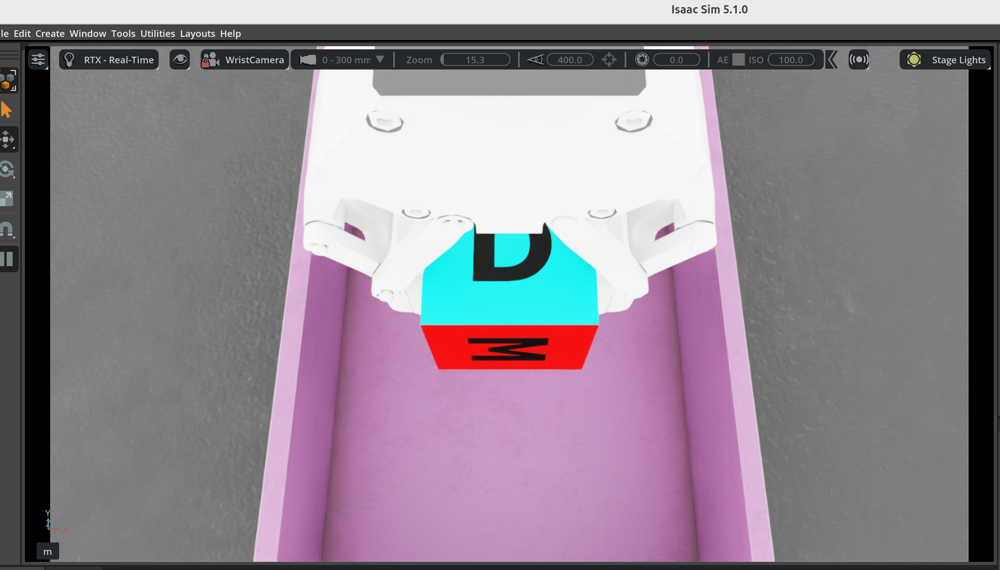
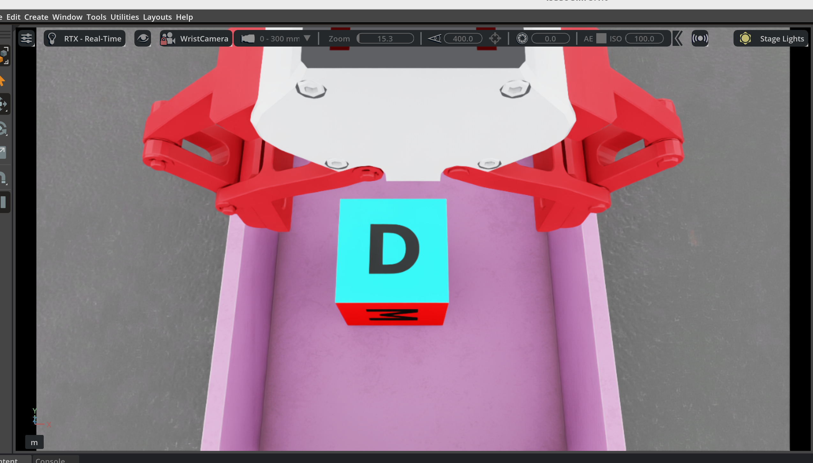
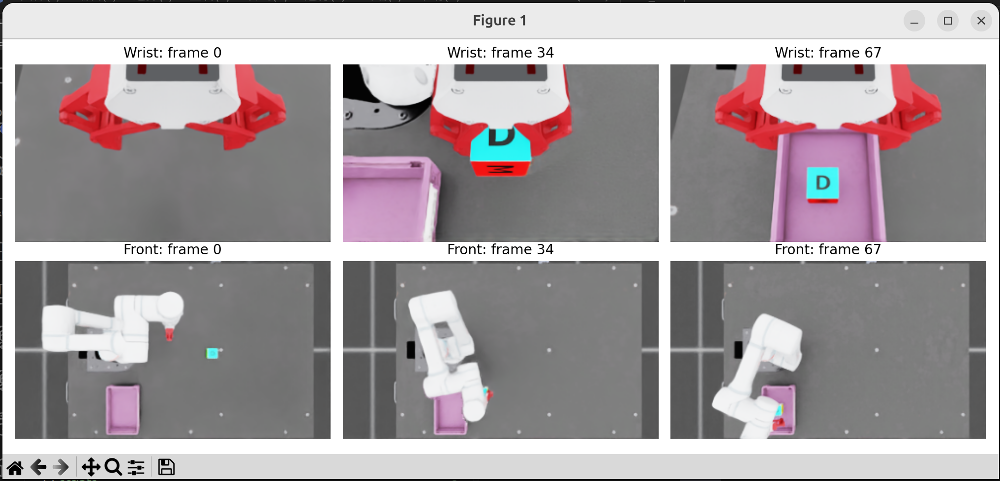

# act_manipulation · v0.1.0（后续增加触觉和残差）

## 1.项目结构和环境安装

1. isaaclab环境

安装isaaclab2.2.1，同时isaacsim是5.1.0版本，看官方安装，那几个RL框架可以都安装上

2. act环境

我的设备，cpu是R7 9700X的CPU，GPU是RTX5060TI 16G  注意这里isaaclab安装最低显存要求是16G，运行内存最低32G
```bash
cd ~/isaac_space_01/act_manipulation

conda create -n env_act python=3.12 -y
conda activate env_act
conda install -c conda-forge ffmpeg -y  #会使用视频编码和解码，官方建议安装 FFmpeg
# 我的驱动是570用的CUDA12.8，在env_act下安装
python -m pip install --upgrade pip

python -m pip install \
  torch==2.10.0 \
  torchvision==0.25.0 \
  --index-url https://download.pytorch.org/whl/cu128

python -m pip install torchcodec==0.10.0 \
  --index-url https://download.pytorch.org/whl/cpu

#安装 LeRobot ACT
python -m pip install \
  'lerobot[training]==0.7.0' \
  'torch==2.10.0' \
  'torchvision==0.25.0' \
  'torchcodec==0.10.0' \
  h5py
```
看看ACT有没有安装完成：
```bash
python -m pip check

python -c "from importlib.metadata import version; print('LeRobot:', version('lerobot'))"

python -c "from lerobot.datasets.lerobot_dataset import LeRobotDataset; from lerobot.policies.act.modeling_act import ACTPolicy; print('LeRobot Dataset & ACT imports OK')"

lerobot-train --help
```

## 2.脚本化专家（IK状态机收集数据流程）

### 2.1 IK状态机设置

- 环境要求和状态机思路
    
    这里延续强化学习和实机部署的IK设置部分，可以适当让PD变得比较软，但是这里注意不能够让它抓不上东西的软弱，只是可以适当延长响应时间，这样抖动这些可能变小

```python
    cd ~/isaac_space_01/IsaacLab
    conda activate env_isaaclab
    ./isaaclab.sh -n #新建外部安装包
    # 然后改代码迁移过来，这里你用官方的lift做迁移也是可以，记得换你要的机械臂，我这里就还是lebai，放在assets里
    # 环境增加一个托盘，两个相机，在source/act_manipulation/act_manipulation/tasks/manager_based/lift/lift_env_cfg.py文件下：
    tray = AssetBaseCfg(……),
    wrist_camera = CameraCfg(……),
    front_camera = CameraCfg(……),# 参数自己看着设置，但是记得和自己要部署的尽量一样
```
- 机械臂配色对比

之前一直没给机械臂配色，因为没怎么用到视觉，现在ACT需要视觉输入，所以还是得配色的，先配一个粗糙版本的吧



### 2.2 专家数据收集
在env_isaaclab下
[这里链接一下收集数据的文件可以看看注释思路是什么](./scripts/record/scripted_act_data_colletion.py)
- 1.确认流程没有错误之后，专家数据成功率要100%，在scripts/record/下设置demo_recorder.py
- 2.把状态机文件也搬到这个文件夹下，增加要收集数据的代码scripted_act_data_colletion.py
- 3.运行修改好的代码看有没有收集5个episode_000000.hdf5
- 4.检查hdf5文件有没有问题，运行inspect_dataset.py会在开始中间和结束都截图看对不对，就是下面这张图
- 5.检查自己对物体的随机域化有没有设置错误，不能只录一个位置的动作，运行initial_position_test.py看输出的物体位置是不是随机的




## 3.数据处理（Schema、转换与回放验证）

### 3.1 将hdf5的数据转换为LeRobot Dataset的数据格式

- 在env_act的环境下，检查收集的数据格式运行scripts/act/inspect_hdf5.py
- 同样环境下运行convert_hdf5_to_lerobot.py,完成从 HDF5 的 uint8、HWC 格式到 LeRobot 的归一化、CHW 格式转换
### 3.2 数据集总体信息
第一轮数据收集

| 项目 | 实际数据 |
|---|---|
| 数据格式 | HDF5 (.hdf5) |
| Episode 数量 | 200 |
| 总帧数 | 13,662 |
| 最小帧数 | 66 |
| 最大帧数 | 72 |
| 平均帧数 | 68.31 |
| 采集频率 | 10 Hz |
| 图像分辨率 | 320 × 180 |
| 相机数量 | 2（Wrist + Front） |
| 机械臂 | Lebai LM3 + LMG90 |
| 专家控制方式 | IK + FSM 状态机 |

### 3.3 HDF5 数据字段

以下是单条 Episode 的数据结构。T 表示当前 Episode 的帧数。

| 数据路径 | Shape（单条 Episode） | 数据类型 | 数据含义 |
|---|---|---|---|
| action | (T, 8) | float32 | 末端目标位姿及夹爪控制 |
| fsm_state | (T,) | int64 | 状态机当前状态 |
| object_position | (T, 3) | float32 | 方块世界坐标 |
| observations/ee_pose | (T, 7) | float32 | 末端位姿 |
| observations/images/wrist | (T, 180, 320, 3) | uint8 | 腕部 RGB 图像 |
| observations/images/front | (T, 180, 320, 3) | uint8 | 外部 RGB 图像 |
| observations/qpos | (T, 12) | float32 | 12 维关节位置 |
| observations/qvel | (T, 12) | float32 | 12 维关节速度 |
| timestamp | (T,) | float64 | 采集时间戳 |

### 3.4 HDF5 根属性（Root Attributes）

| 属性名称 | 示例值 | 含义 |
|---|---|---|
| action_format | x,y,z,qw,qx,qy,qz,gripper | 动作维度定义 |
| fps | 10 | 数据采集频率 |
| num_frames | 70 | 示例 Episode 帧数 |
| fsm_done | True | 状态机执行完成 |
| success | -1 | 成功标记，当前未有效标注 |
| termination_reason | fsm_completed | 终止原因 |
| joint_names | 12 个关节名称 | 关节排列顺序 |

### 3.5 数据质量检查结果

- 状态说明
| 检查项目 | 检查结果 | 说明 |
|---|---|---|
| Episode 完整性 | 通过 | 200 条数据均已保存 |
| 图像数据 | 通过 | 双相机 RGB 数据完整 |
| 关节状态 | 通过 | qpos、qvel 维度正常 |
| 动作数据 | 通过 | 8 维动作，包含夹爪开合 |
| 状态机完成 | 通过 | 200 条均为 True |
| 成功标签 | 待完善 | success 全部为 -1 |
| 深度图数据 | 未采集 | 当前版本只使用 RGB |

2. hdf5转换成lerobot的数据
```bash
cd ~/isaac_space_01/act_manipulation
conda activate env_act

python scripts/act/convert_hdf5_to_lerobot_25hz.py \
    --scan-only  #检查FPS、时间戳、RGB、Depth、34维状态所需字段和成功标签。
#如果成功轨迹不足200条，但想先用现有成功数据训练
python scripts/act/convert_hdf5_to_lerobot_25hz.py \
    --allow-fewer-successes
# 然后正式转换数据：
python scripts/act/convert_hdf5_to_lerobot_25hz.py
```

## 4.ACT训练配置、依赖版本、checkpoint 说明

### 4.1第一轮ACT训练的参数设置：
| 参数 | 建议值 | 原因 |
|---|---|---|
| batch_size | 8 | 先保证显存稳定 |
| chunk_size | 30 | 预测未来 3 秒 |
| n_action_steps | 10 | 每执行 1 秒重新推理 |
| learning rate | 1e-5 | ACT 默认学习率 |
| steps | 30000 | 第一轮基线训练 |
| vision backbone | ResNet18 | ACT 默认视觉骨干 |
| use_vae | True | 保留 ACT 原始结构 |

运行指令：(暂时不传huggingface,这里还需要注意的是batch_size，不一定是越大越好，需要根据这个任务情况和电脑配置情况)
较大的 batch 不一定带来更好的泛化能力。第一轮应该先获得一个可靠的训练基线
```bash

conda activate env_act
cd ~/isaac_space_01/act_manipulation

lerobot-train \
    --dataset.repo_id=local/lebai_lm3_pick_place_v1 \
    --dataset.root=datasets/lerobot/lebai_lm3_pick_place_v1 \
    --policy.type=act \
    --policy.device=cuda \
    --policy.push_to_hub=false \
    --policy.chunk_size=30 \
    --policy.n_action_steps=10 \
    --batch_size=8 \
    --steps=30000 \
    --output_dir=outputs/train/act_lebai_lm3_v1 \
    --job_name=act_lebai_lm3_v1
    #是否开启训练参数查看：
    --trackio.enable=true \
    --trackio.project=<名字>
    #评估代码
    python scripts/act/eval_act_isaaclab_v2.py     --checkpoint /home/l/isaac_space_01/act_manipulation/outputs/train/act_lebai_lm3_v6/checkpoints/060000/pretrained_model     --num-episodes 1
    # 实验3和实验4的评估代码：
    set -o pipefail

    python scripts/act/eval_act_isaaclab_v7.py \
        --checkpoint outputs/train/act_lebai_lm3_25hz/checkpoints/060000/pretrained_model \
        --policy-fps 25 \
        --max-policy-steps 240 \
        --success-stable-steps 13 \
        --num-episodes 100 \
        --output-dir outputs/eval/act_lebai_lm3_25hz \
        --headless \
        2>&1 | grep --line-buffered -v '^\[DEBUG\]'
```

## 5.效果分析Loss、成功率、失败案例
### 5.1 实验设计和数据使用设计
Observation / Action 数据使用矩阵

☑ 表示当前实验已经使用；☐ 表示待选择。实验 1 根据当前实际训练配置预填。

| 数据字段 | 数据格式 | 实验 1 | 实验 2 | 实验 3 | 实验 4 | 实验 5 |
|---|---|---|---|---|---|---|
| Wrist RGB | (3,180,320) | ☑ | ☑ | ☑ | ☐ | ☐ |
| Front RGB | (3,180,320) | ☑ | ☑ | ☑ | ☐ | ☐ |
| Joint Position | (12,) | ☑ | ☑ | ☑ | ☐ | ☐ |
| Joint Velocity | (12,) | ☐ | ☑ | ☑ | ☐ | ☐ |
| EE Pose | (7,) | ☐ | ☑ | ☑ | ☐ | ☐ |
| Object Position | (3,) | ☐ | ☐ | ☑ | ☐ | ☐ |
| FSM State | (1,) | ☐ | ☐ | ☐ | ☐ | ☐ |
| Depth Image | 当前未采集 | — | — | — | — | — |
| Action Label | (8,) | ☑ | ☑ | ☐ | ☐ | ☐ |

实验设计表格：
| 实验记录 | 实验 1 | 实验 2 | 实验 3 | 实验 4 | 实验 5 |
|---|---|---|---|---|---|
| 实验名称 | ACT Baseline | 待定 | 待定 | 待定 | 待定 |
| Batch Size | 8 | 8 | 8 | — | — |
| Chunk Size | 30 | 30 | 30 | — | — |
| Action Steps | 10 | 10 | 10 | — | — |
| Learning Rate | 1e-5 | 1e-5 | 1e-5 | — | — |
| Training Steps | 30000 | 60000 | 60000 | — | — |
| Vision Backbone | ResNet18 | ResNet18 | ResNet18 | — | — |
| VAE | True | True | — | — | — |
| Train L1 Loss | 待填写 | — | — | — | — |
| Validation L1 Loss | 待填写 | — | — | — | — |
| KL Loss | 待填写 | — | — | — | — |
| 抓取成功率 | 0 | 0 | 35% | % | — |
| 放置成功率 | 0 | 0 | 35% | % | — |
| 完整任务成功率 | 0 | — | 35% | — | — |
| 平均推理时间 | 0 | — | — | — | — |
| 实验结论 | 0 | — | — | — | — |

### 5.2 实验结果

实验1和实验二一开始都没对上，视频如下,右边是IK的专家视频

 

实验3的结果视频，成功率大概35%

 

### 5.3 LeRobot 0.7.0 用什么看训练曲线
- 使用`trackio show --project lebai_act_25hz`看，像tensorboard

## 6.视频专家抓取与 ACT 自主抓取对比
### 6.1抓取放置的专家数据视频
# Lebai-RoboACT
