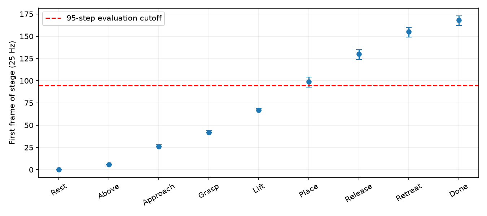
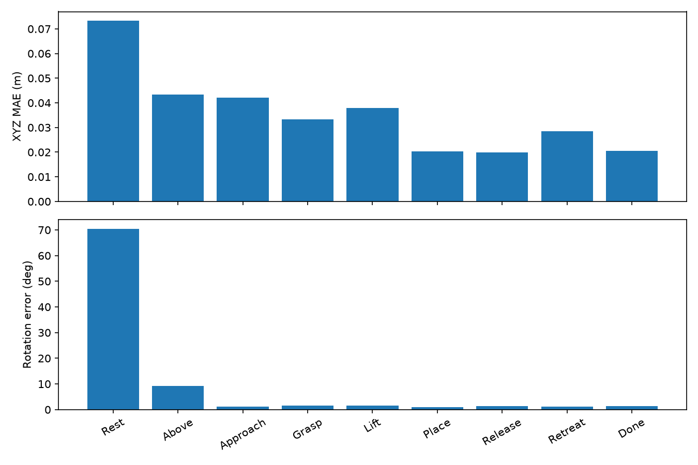
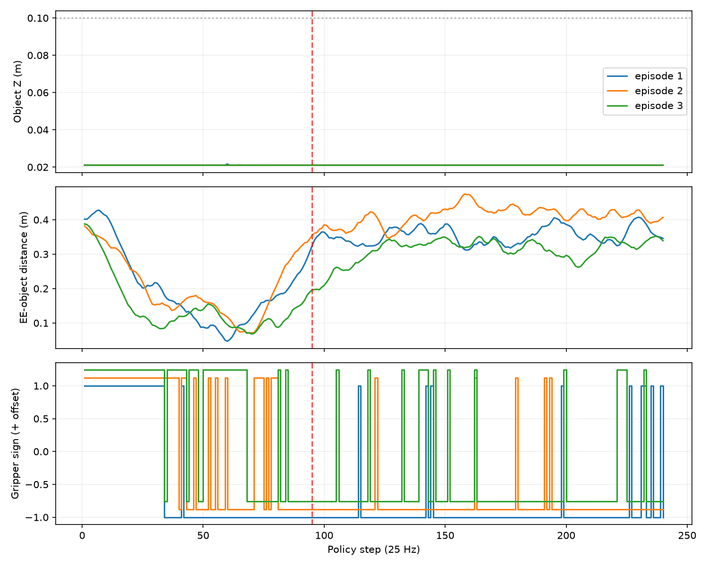

# Lebai LM3 + LMG90：25 Hz SmolVLA 仿真实验

本项目把 Isaac Lab 中的成功抓取放置示教转为 LeRobot Dataset，微调 `lerobot/smolvla_base`，再通过现有 Absolute IK 控制接口闭环评估。SmolVLA 是带视觉、语言条件和动作专家的预训练策略；这里用它检验双相机、关节与末端状态能否学习单任务的 8D 位姿动作。原 ACT 数据、权重和控制器保留独立。**目前 1000 步模型闭环未成功；本页是复现说明，证据与失败分析见 [实验报告](experiment_report.md)。**

```text
Isaac Lab 脚本专家成功示教 → 25 Hz HDF5 → LeRobot 34D ACT 数据
  → 独立的 31D SmolVLA 数据视图 → 官方 LeRobot 预处理 / 微调
  → 8D 绝对末端位姿预测 → 后处理 / 安全过滤 / Absolute IK
  → Isaac Lab 25 Hz 策略、50 Hz 环境执行 → 几何成功率
```

语言输入固定为 `Pick up the cube and place it into the tray.`。单任务数据没有指令变化，因此本实验无法证明模型学会了语言泛化。

## 1. 目录与环境

以下命令均从项目根目录 `~/isaac_space_01/act_manipulation` 执行。代码、数据与结果的实际位置：

| 用途 | 路径 |
|---|---|
| 25 Hz 专家采集 | `scripts/record/scripted_act_data_colletion_25hz.py` |
| 34D ACT 数据及划分 | `datasets/lerobot/lebai_lm3_pick_place_25hz/{train,val}`，`split_manifest.json` |
| 31D 数据准备/校验 | `smolvla_lebai/scripts/{prepare_smolvla_dataset,validate_dataset}.py` |
| 31D 数据 | `datasets/lerobot/lebai_lm3_pick_place_25hz_smolvla31/{train,val}` |
| 训练配置/入口 | `smolvla_lebai/configs/train.yaml`，`smolvla_lebai/scripts/train_smolvla_lebai.sh` |
| 离线推理/闭环 | `smolvla_lebai/scripts/{test_smolvla_inference,rollout_smolvla_isaac}.py` |
| 安全控制与成功判定 | `scripts/act/eval_act_isaaclab_v2.py` |
| 1000 步 checkpoint | `outputs/train/smolvla_lebai_1000/checkpoints/001000/pretrained_model` |
| 原始评估与本轮诊断 | `outputs/eval/smolvla_isaac_20`，`outputs/eval/smolvla_diagnostics` |

实验主机为 Ubuntu 24.04.4、RTX 5060 Ti 16 GB；本机 `/proc/driver/nvidia/version` 与包记录显示 NVIDIA 570.211.01。项目 README 记录 Isaac Lab 2.2.1 / Isaac Sim 5.1.0。SmolVLA 独立环境实测 LeRobot 0.7.0、PyTorch 2.10.0+cu128、Transformers 5.22.2。Isaac Lab 使用 `/home/l/miniconda3/envs/env_isaaclab/bin/python`，不要把其包安装到训练环境。下列创建/安装命令曾在该机器成功执行；**现有环境已创建，复现本轮诊断无需重跑安装。**

```bash
cd ~/isaac_space_01/act_manipulation
conda create -y -p "$PWD/.conda/smolvla_lebai" --clone /home/l/miniconda3/envs/env_act
"$PWD/.conda/smolvla_lebai/bin/python" -m pip install 'transformers>=5.22,<5.23' 'num2words>=0.5.14,<0.6' 'matplotlib>=3.8,<4'
"$PWD/.conda/smolvla_lebai/bin/python" -m pip check
nvidia-smi
```

克隆现有 `env_act` 使 Isaac Lab 运行时与 LeRobot/Transformers 依赖分离。新机器应按驱动、CUDA 和 LeRobot 的兼容性重新建环境，不能机械复用这条本机路径命令。

## 2. 数据、状态与动作

原始 HDF5 为 200 条成功示教；按 Episode 固定划分 160 train / 40 val，分别 27799 / 6947 帧，25 Hz。两路 AV1 RGB 为 `180×320×3`，`front` 看全局，`wrist` 看末端视野。31D 副本只取原 34D 状态的前 31 维，保留视频硬链接和 8D action，重新生成对应统计，不覆盖原数据。原 34D 末尾 `object_rel_x/y/z` 是物体相对末端的仿真真值；删掉它避免推理依赖物体真值。夹爪的多个 mimic 关节仍保留，因为它们属于原始实际关节状态和动作状态历史，不能在不重建模型特征/统计的情况下再删除。

| 维度 | `observation.state` 字段 | 含义与单位 |
|---|---|---|
| 0–5 | `qpos_joint_1` … `qpos_joint_6` | 六轴实际位置，rad |
| 6–11 | `qpos_gripper_l_joint1/2`, `qpos_gripper_r_joint1/2`, `qpos_gripper_l/r_joint_finger` | 夹爪实际关节位置，rad |
| 12–17 | `qvel_joint_1` … `qvel_joint_6` | 六轴实际速度，rad/s |
| 18–23 | 对应六个 `qvel_gripper_*` | 夹爪实际关节速度，rad/s |
| 24–26 | `ee_x,ee_y,ee_z` | 当前实际末端在环境局部坐标系的位置，m |
| 27–30 | `ee_qw,ee_qx,ee_qy,ee_qz` | 当前实际末端绝对姿态，WXYZ |

具体顺序可由 `datasets/lerobot/lebai_lm3_pick_place_25hz_smolvla31/train/meta/info.json` 的 `features.observation.state.names` 核查。训练与评估均用 31D；后者复用 ACT v2 的 `STATE_NAMES`/`get_observation`。Front/Wrist 经保存的 `rename_map` 分别进入模型 `camera1/camera2`，两端调用同一个 LeRobot preprocessor/postprocessor。输入视频由 LeRobot 解码为 RGB `float32 CHW`；仿真原始 RGB `uint8 HWC` 经 `build_inference_frame` 与相同处理器转换。SmolVLA 内部进行 512×512 resize/pad 和图像数值映射。

| Action 维度 | 定义 |
|---|---|
| 0–2 | 环境局部坐标系的**绝对** EE 目标 `x,y,z`，m |
| 3–6 | 绝对 EE 目标四元数 `qw,qx,qy,qz`，WXYZ；`q` 与 `-q` 表示同一旋转 |
| 7 | 夹爪 `+1` 张开、`-1` 闭合；执行端按符号判定 |

模型输出先由 LeRobot postprocessor 反归一化，得到原始 8D 预测；`sanitize_action` 随后做四元数单位化/符号连续、工作空间与速度限制，才送入 Isaac Lab 的 Absolute IK。训练 Action 没有改为 Relative IK。**原始预测、过滤后目标、实际末端位姿是三种不同量。**

## 3. 模型与已完成训练

| 参数 | 实际值 | 选择原因 |
|---|---|---|
| 基座 | `lerobot/smolvla_base` | 复用预训练视觉语言与动作专家权重；本地配置视图只适配 31D/双相机/8D |
| 数据与种子 | 160 train / 40 val；`20261117` | Episode 不交叉，训练采样可复现 |
| batch / 精度 | 1 / bf16 | 16 GB GPU 上已完成 CUDA 训练；不是吞吐最优证明 |
| `chunk_size` / `n_action_steps` | 50 / 10 | 一次预测未来 50 帧，闭环执行前 10 帧再观测和重规划；不是 50 帧开环 |
| 视觉编码器 | 冻结 | 降低微调显存；不等于视觉输入未参与前向 |
| 训练模块 | `train_expert_only=true`, `train_state_proj=true` | 主要更新 action expert，并适配新状态维度 |
| 优化步 | smoke 20，试验性微调 1000 | 验证流程与初步行为；未声称充分训练 |
| checkpoint | 每 200 步；最终 `001000` | 支持同权重对比，不覆盖旧结果 |

官方 LeRobot 预处理使用训练集状态/动作统计；checkpoint 保存了模型配置、预处理与后处理。训练时的 50 帧监督窗口彼此大量重叠。1000 次 batch=1 抽样重建覆盖全部 160 条训练 Episode 的 1000 个不同观测帧、21084 个不同未来动作标签帧（占 27799 帧约 75.8%）；索引未被原训练日志逐条保存，数值是按 LeRobot 0.7.0 采样器与种子重建。详见报告。

## 4. 操作命令

所有命令在项目根目录执行。`PY` 是 SmolVLA 独立环境；`ISAAC_PY` 是 Isaac Lab 环境。**以下训练命令仅供从零复现，当前诊断暂停训练，现有输出目录不会被脚本覆盖。**

```bash
cd ~/isaac_space_01/act_manipulation
PY="$PWD/.conda/smolvla_lebai/bin/python"
ISAAC_PY=/home/l/miniconda3/envs/env_isaaclab/bin/python
"$PY" smolvla_lebai/scripts/inspect_dataset.py
"$PY" smolvla_lebai/scripts/validate_dataset.py
```

从原 34D 数据建立**新路径**的数据视图时使用下列命令；当前默认目标已存在，脚本会拒绝覆盖：

```bash
"$PY" smolvla_lebai/scripts/prepare_smolvla_dataset.py --target datasets/lerobot/lebai_lm3_pick_place_25hz_smolvla31_new
```

首次准备预训练文件时曾使用：

```bash
HF_HUB_DISABLE_XET=1 "$PY" -c 'from huggingface_hub import snapshot_download; snapshot_download("lerobot/smolvla_base", local_dir="smolvla_lebai/pretrained/smolvla_base", allow_patterns=["config.json", "model.safetensors", "policy_preprocessor.json", "policy_postprocessor.json", "*.safetensors"])'
"$PY" smolvla_lebai/scripts/prepare_checkpoint.py
```

历史训练及其结果：

```bash
bash smolvla_lebai/scripts/train_smolvla_lebai.sh 20
bash smolvla_lebai/scripts/train_smolvla_lebai.sh 1000
"$PY" smolvla_lebai/scripts/plot_loss.py
```

只读的离线预测、仿真 dry run 与诊断性闭环：

```bash
"$PY" smolvla_lebai/scripts/test_smolvla_inference.py --checkpoint outputs/train/smolvla_lebai_1000 --episodes 40 --fsm-windows --frames-per-episode 10 --output outputs/eval/smolvla_lebai/val_fsm_windows_new.json
"$ISAAC_PY" smolvla_lebai/scripts/rollout_smolvla_isaac.py --smol-dry-run --headless
"$ISAAC_PY" smolvla_lebai/scripts/rollout_smolvla_isaac.py --headless --num-episodes 3 --max-policy-steps 240 --smol-seed 20261118 --output-dir outputs/eval/smolvla_h240_new
```

`--smol-seed` 给每个 Episode 的环境 reset 与模型采样分别设种子 `base + episode_index`。仿真桥保留双进程；每次 reset 清空动作队列和处理器。`--smol-dry-run` 不调用 `env.step()`。两个环境的 25 Hz 是**仿真策略时间**：底层 `sim.dt=0.01s`，环境 decimation=2，故每策略动作执行两次 50 Hz `env.step()`；实际墙钟受推理和渲染影响。测得重规划约 0.126s，超过 40ms，不能推断实机实时 25 Hz。

## 5. 当前结果

| 结果 | 来源与读法 |
|---|---|
| 训练第 1000 步 loss ≈0.136 | `outputs/train/smolvla_lebai_1000.log`；训练目标 loss，不是成功率 |
| 按 FSM 阶段采样的验证 XYZ MAE 0.0343 m；旋转角 7.33°；夹爪 96.13% | 40 个验证 Episode、3280 帧；离线专家观测，不闭环 |
| 夹爪切换窗口准确率 59.06% | 40 条验证 Episode 的抓取/松爪窗口，共 1600 帧；全局准确率掩盖切换困难 |
| 单次重新规划约 0.126s | 离线 1200 帧试验性样本；与渲染墙钟频率区别 |
| 原 95 步仿真成功 0/20；固定种子 240 步 0/3 | 延长时长仍未抬起物体 |
| 同环境脚本专家 3/3 | 重新运行脚本 FSM，不是逐字节回放旧 HDF5 |





## 6. 已遇问题与边界

- **CUDA `sm_120`**：先用独立环境验证 PyTorch CUDA 矩阵运算，再启动训练；本机 PyTorch 2.10.0+cu128 实测可用。训练和仿真 Python 不能混用。
- **Hugging Face 下载**：Xet/代理连接曾中断；`HF_HUB_DISABLE_XET=1` 后完成本地权重下载。`prepare_checkpoint.py` 建立特征配置视图，权重哈希不变。迁移到离线机器需同时准备 tokenizer/processor 配置。
- **特征维度与相机键名**：31D 与 34D checkpoint 不可互换；确认 `features.names`、`rename_map`、保存的归一化统计以及两路相机顺序。
- **Action Chunk**：`chunk_size=50` 是输出/训练窗口，`n_action_steps=10` 是实际队列长度；重规划边界可产生较大原始 XYZ 跳变。
- **四元数**：原始输出范数可能偏离 1；执行前归一化。统计角误差使用 `abs(q_pred·q_true)` 处理符号等价。日志的 `quaternion_adjusted` 主要含符号连续翻转，不能直接当作物理旋转被改动。
- **工作空间和速度**：模型动作常触发 0.5 m/s 的每步 0.02 m XYZ 限制；限幅后的目标与模型原始输出有明显差距，见 [实验报告](experiment_report.md)。
- **时间与成功条件**：95 步只对应 3.8s，专家中位首次松爪在 5.2s；240 步对应 9.6s，仍在环境 10s 上限内。训练 loss 下降和离线帧准确率都不能替代闭环抓取/放置成功率。
