# SmolVLA 25 Hz：0/20 闭环失败诊断报告

日期：2026-11-17 至 2026-11-18。项目根目录：`~/isaac_space_01/act_manipulation`。本轮只重算已有数据、做固定种子诊断性仿真和脚本专家验证；**没有增加训练步数或修改 ACT/PPO 权重、原始示教、机器人控制器及 PD**。所有数值以下述具体日志为准。文档安装与操作见 [README](README_smolvla.md)。

## 1. 问题、假设与判据

1000 步 SmolVLA checkpoint 在原 95 策略步评估中 0/20 成功。依次检验：①95 步是否先于专家完成动作；②延长到合理 horizon 是否足以恢复成功；③同一控制接口能否执行专家；④数据/动作对齐、安全过滤和动作队列是否破坏模型命令；⑤训练覆盖、离线阶段误差和夹爪切换是否显示行为问题。**已证实**指由代码/数值/仿真直接测量；**推测**指证据支持但未做隔离干预；**待验证**留给单变量实验。

主要路径：

| 证据 | 路径 |
|---|---|
| 最终 checkpoint / 训练日志 | `outputs/train/smolvla_lebai_1000/checkpoints/001000/pretrained_model`；`outputs/train/smolvla_lebai_1000.log` |
| 训练配置 / 数据集 | `smolvla_lebai/configs/train.yaml`；`datasets/lerobot/lebai_lm3_pick_place_25hz_smolvla31/{train,val}` |
| 原 20 条闭环 | `outputs/eval/smolvla_isaac_20/{summary.csv,steps.csv}` |
| 固定种子 95 / 240 步 | `outputs/eval/smolvla_h95_seed20261118`；`outputs/eval/smolvla_h240_seed20261118_retry` |
| 专家脚本验证 | `outputs/eval/expert_replay_25hz_3/episode_*.hdf5` |
| 离线 FSM / 切换窗口 | `outputs/eval/smolvla_lebai/{train_fsm_windows,val_fsm_windows,val_transition_windows}.json` |
| 统计、覆盖与前向 loss | `outputs/eval/smolvla_diagnostics/{metrics,training_coverage,checkpoint_loss}.json` |
| 诊断代码 | `smolvla_lebai/scripts/{diagnose_failure,plot_horizon,analyze_training_coverage,eval_checkpoint_loss}.py` |

原 200 条成功 HDF5 按 Episode 固定划分 160/40；train 27799 帧、val 6947 帧，25 Hz，双路 RGB，34D 原状态裁前 31D，8D `[x,y,z,qw,qx,qy,qz,gripper]` 绝对位姿动作。数据与评估均用环境局部坐标系，位置 m、四元数 WXYZ、夹爪 `+1` 开 / `-1` 关。模型 `chunk_size=50`、`n_action_steps=10`、batch=1、bf16、seed=20261117、冻结视觉编码器，训练 1000 步。模型输出由保存的 LeRobot postprocessor 还原物理量；ACT v2 控制桥对模型和脚本专家沿用 Absolute IK 与相同动作安全规则。

## 2. 95 步 horizon：确实提前截断

`scripts/act/eval_act_isaaclab_v2.py` 用 `min(max_policy_steps, 按剩余 episode 秒数换算的步数)` 作循环上限；这里 `95` 实际限制每条 episode。`lift_env_cfg.py` 中 `sim.dt=0.01s`、`decimation=2`，故环境一步 0.02s；策略 25 Hz 一动作执行 2 个 `env.step()`，即 0.04s。95 步为 3.8s，240 步为 9.6s，后者在 10s 环境时限内。成功判定需物体进入托盘几何范围、夹爪张开、物体速度小于 0.04 m/s 并稳定 5 策略步（0.2s）。**采集器**对成功的稳定时长设置为 0.5s；因此采集与评估的时间阈值不完全相同，不能把其成功标签当作同一判据的回放结果。

直接扫描 200 条原 HDF5 的 `fsm_state`：episode 长度最短 167 帧，中位 174，P90 179，P95 180，最长 183，平均 173.73 帧（6.949s）。train/val 按相同来源采样，合并统计用于任务时序判断。

| 首次进入阶段 | FSM ID | 中位帧 | 中位时间 |
|---|---:|---:|---:|
| Rest | 0 | 0 | 0.00s |
| Above | 1 | 6 | 0.24s |
| Approach | 2 | 26 | 1.04s |
| Grasp/闭合 | 3 | 42 | 1.68s |
| Lift | 4 | 67 | 2.68s |
| Place | 5 | 99 | 3.96s |
| Release/张开 | 6 | 130 | 5.20s |
| Retreat | 7 | 155 | 6.20s |
| Done | 8 | 168 | 6.72s |

在第 95 帧，164/200 条专家处于 Lift，36/200 处于 Place，**没有任何一条达到 Release**。所以原 95 步条件即使给专家，也不足以按当前成功判据完成任务。此结论只说明 0/20 中存在提前截断因素，不能说明模型若延长就会成功。

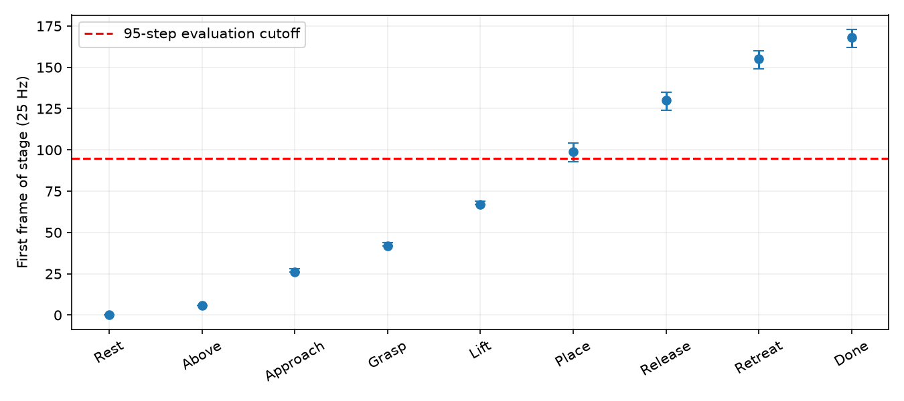

## 3. 固定种子延长时长与专家对照

用同一 1000 步 checkpoint、`--smol-seed 20261118` 运行每组 3 个 episode。包装器把 `20261118+i` 传给第 `i` 个环境 reset 和模型随机数；两组同序号的**初始物体 XYZ 完全相同**。Isaac 物理与图像运行不保证整条轨迹逐位一致，故这是固定初始物体/种子的配对诊断，不宣称完整初始观测位级相同。240 步运行因默认端口占用改用 `--port 18766`；控制参数、模型权重不变。

| 条件 | 成功 | 终止 | 物体抬升 | 观察 |
|---|---:|---|---|---|
| 原始 95 步、未显式固定环境 seed | 0/20 | 全部 95 步 | 0/20 | 不能完成专家所需 5.2s 后的松爪 |
| 固定 seed 95 步 | 0/3 | 全部 95 步 | 无有效抬升 | 与延长组同初始物体位置 |
| 固定 seed 240 步 | 0/3 | 全部 240 步 | 最高约 0.021–0.022m | 没有进入托盘；末端已向托盘侧移动，但物体留在桌面 |
| 同环境 25 Hz 脚本专家 | 3/3 | FSM Done | 最高约 0.199m | 长度 172、170、173 帧 |

固定 seed 的失败关键帧来自真实仿真相机：

| 时间 | Front | Wrist |
|---|---|---|
| 95 步 / 3.8s | 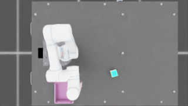 | 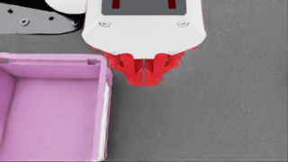 |
| 240 步 / 9.6s | 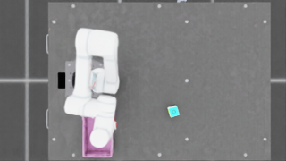 | 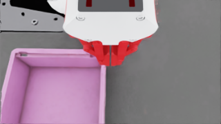 |

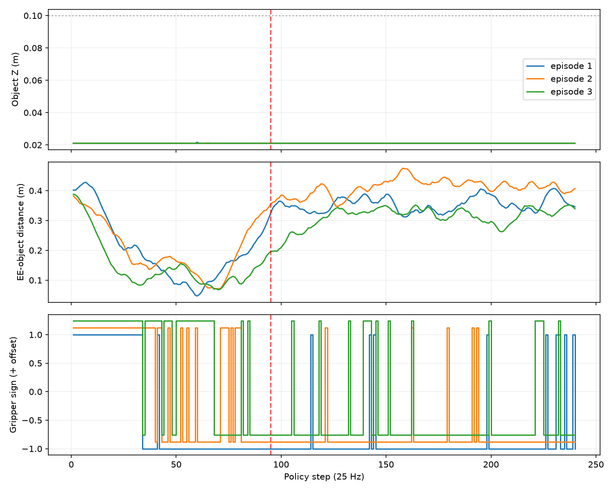

**已证实**：延长 horizon 可消除“专家尚未到松爪阶段”的必然截断，却未修复 SmolVLA 的抓取/抬升失败。脚本专家测试是在当前 Isaac Lab 配置重新计算 FSM 动作，**不是逐帧注入旧 HDF5 的字节级 replay**；它证明同一类控制接口与 PD 在现行环境仍能完成任务，不能单独证明旧数据与运行时全部状态一致。原 HDF5 中 200 条自身也均标注成功。原 20 条模型轨迹中仅 3/20 的末端到物体最小距离小于 5cm，中位最小距离 0.108m；多数模型很早发出闭合又重新张开，常在未抬起物体时向托盘移动。

## 4. 动作对齐、过滤与队列

采集器先用上一目标推进环境，再读取当前实际观测/相机，FSM 计算**当前观测对应的新动作**，同帧记录；转换器逐帧读取同一个 HDF5 index 的 state/action。诊断程序核对验证集专家 action 与源 HDF5，最大绝对差 `0.0`。LeRobot 片段把每条 HDF5 首帧约 0.04s 的时间重新记为 0.00s，但 state 与 action 索引同移，没有发现单帧错位。模型和专家语义均为环境局部坐标系的 8D Absolute Pose；当前没有证据支持切换 Relative IK。

使用 ACT v2 的 `sanitize_action` 顺序处理 200 条专家轨迹 34746 帧，并与原 20 条闭环模型轨迹 1900 帧比较：

| 项目 | 专家 | SmolVLA | 解释 |
|---|---:|---:|---|
| 工作空间标志 | 0% | 4.68% | 模型可越 `x_max=0.52m` |
| 速度标志 | 11.83% | 80.32% | 专家标志主要为浮点边界公差 |
| 原始→执行 XYZ 改动均值 | ~`8e-10m` | `0.03663m` | 直接量化命令被改写的幅度 |
| XYZ 改动 >1mm | 0% | 79.58% | 模型安全过滤有实际控制影响 |
| XYZ 改动 P95 | ~`4e-9m` | `0.12922m` | 模型目标大幅改变 |
| 相邻原始 XYZ 跳变均值 | 专家 `0.00681m` | 模型 `0.04621m` | 模型变化常超 0.02m/帧上限 |
| 模型重规划边界原始 XYZ 跳变均值 | — | `0.10135m` | 队列内相邻步均值 `0.04037m` |
| `quaternion_adjusted` 标志 | 95.97% | 68.05% | 多为符号连续处理；不等于物理旋转被改动 |

专家 11.83% 速度标志对应最大 XYZ 改动仅 `6.5e-8m`，所以不能用标志次数断言专家被严重限幅。模型执行 XYZ 相邻步均值 `0.01872m`、最大约 `0.02000m`，符合 `0.5m/s × 0.04s` 上限。模型离线阶段化输出四元数范数均值 0.967、最大 1.707，未见范数 <0.1；执行前归一化。角误差计算先归一化两四元数并取 `abs(dot)`，正确处理 `q`/`-q` 同旋转。`quaternion_adjusted` 代码只对异常回退或符号连续翻转记标志，**不是所有归一化的计数**。

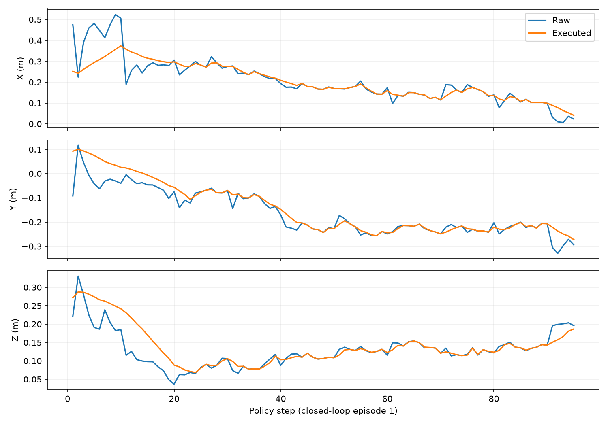
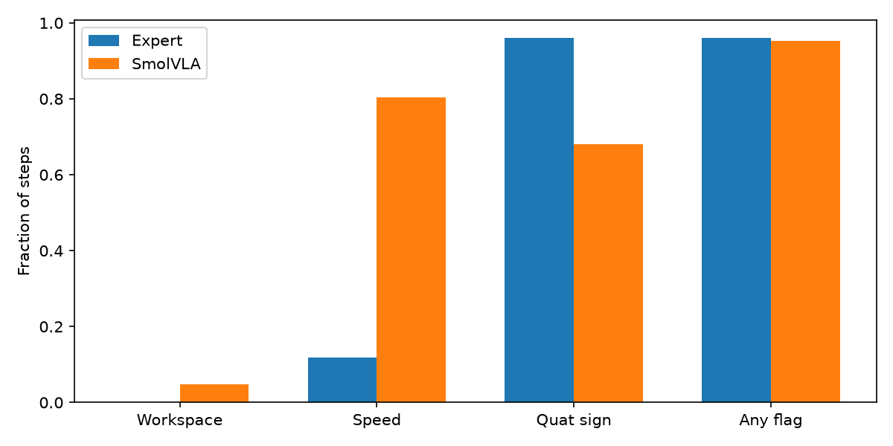

**推测**：大幅原始目标跳变与速度限幅使末端落后于模型意图，并在每 10 步重规划处放大；尚未通过单变量干预测出它相对视觉/行为误差的独立因果贡献。原 20 条轨迹的随机种子没有显式固定，比例是描述统计，不是配对干预估计。

## 5. 训练覆盖、前向 loss 与离线预测

LeRobot 0.7.0 的 map-style `EpisodeAwareSampler(shuffle=True, seed=20261117)` 打散**帧索引**，不是按 episode 连续抽取。重建最初 1000 次 batch=1 抽样：1000 个不同观测帧、覆盖 160/160 条训练 Episode，每 Episode 2–12 个观测，阶段 0–8 样本数分别 43/120/79/132/183/185/150/65/43。每次有未来 50 帧 action 监督，共 50000 个名义标签位置；重叠后为 21084 个不同未来 action 帧，约占训练 action 帧 75.84%。**不能再用 `1000/27799≈0.04 epoch` 推论只见过 6 条 Episode 或只有 3.6% 的动作监督。**由于原始逐步采样索引没有保存，这些覆盖数是根据确定性采样器重建，属于可核验估计；它们也不能证明所有阶段已学好。

`eval_checkpoint_loss.py` 对保存的 200/1000 步 checkpoint 做**只前向、不训练**的阶段均衡对照：每个 split 前 10 Episode × 9 个 FSM 阶段中点 = 90 个观测，固定每样本随机数，同一 50 帧监督窗口。其 flow matching loss 是随机训练目标，不等同于动作 MAE。

| Checkpoint | Train 前向 loss | Val 前向 loss |
|---|---:|---:|
| 200 | 0.5725 | 0.5631 |
| 1000 | 0.1343 | 0.1321 |

两组同降且未见明显 train/val gap；90 帧/组样本量与随机目标有限，不能排除更细阶段过拟合。1000 步原训练日志第 10 步约 1.312、第 1000 步约 0.136；loss 曲线如下。已有 20 步 smoke test 完成 forward/backward/optimizer，独立于 1000 步正式试验。

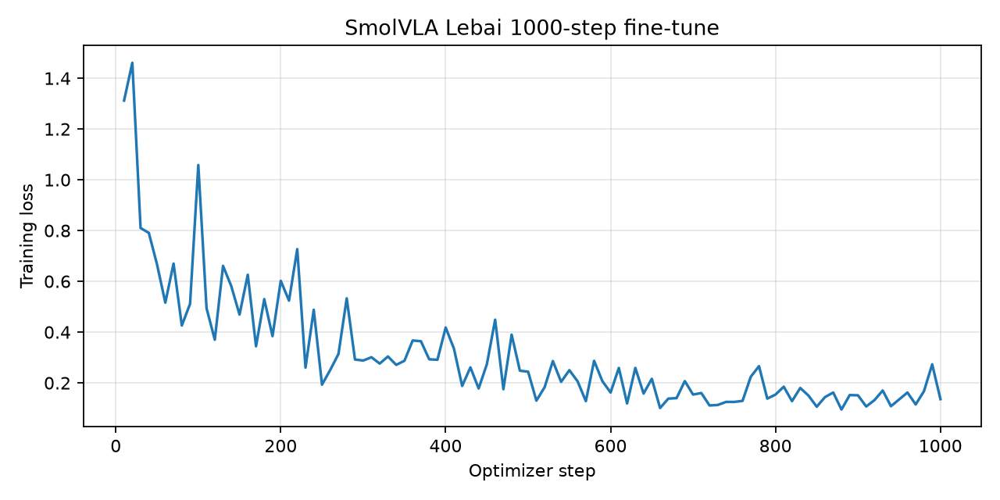

原先 1200 帧验证样本取每条 Episode 的首/中/末 10 帧，得到 XYZ MAE `0.0423m`、角误差 `18.12°`、夹爪 `99.83%`；该样本**完全漏掉 Approach、Grasp、Place、Release**，不能代表完整任务。新样本按 40 条验证 Episode 的 9 个 FSM 阶段各取连续 10 帧（Rest/Done 6 帧），共 3280 帧，仍用真实观测、每窗口重置动作队列、不反馈预测动作：验证 XYZ MAE `0.03433m`、平均角误差 `7.33°`、夹爪 `96.13%`。同法抽首 40 条训练 Episode 为 `0.03387m`、`6.81°`、`96.37%`，未显示显著 train/val 误差差距。

| FSM 阶段 | Val 帧数 | XYZ MAE | 角误差 | 夹爪准确率 |
|---|---:|---:|---:|---:|
| Rest | 240 | 0.0733m | 70.4° | 99.2% |
| Above | 400 | 0.0434m | 9.2° | 100% |
| Approach | 400 | 0.0420m | 1.2° | 85.8% |
| Grasp | 400 | 0.0333m | 1.5° | 94.5% |
| Lift | 400 | 0.0380m | 1.6° | 100% |
| Place | 400 | 0.0203m | 1.0° | 88.5% |
| Release | 400 | 0.0198m | 1.4° | 100% |
| Retreat | 400 | 0.0284m | 1.3° | 100% |
| Done | 240 | 0.0206m | 1.4° | 100% |

Rest 大角误差可能受初始姿态与分段队列首动作影响，需读逐帧结果，不能据阶段平均断定所有时刻姿态失控。按 chunk offset 0–9 的位置误差由约 0.0445m 降到 0.0274m；这是不同阶段窗口混合后得到的描述结果，**不能独立证明**首动作本身比后续预测差。

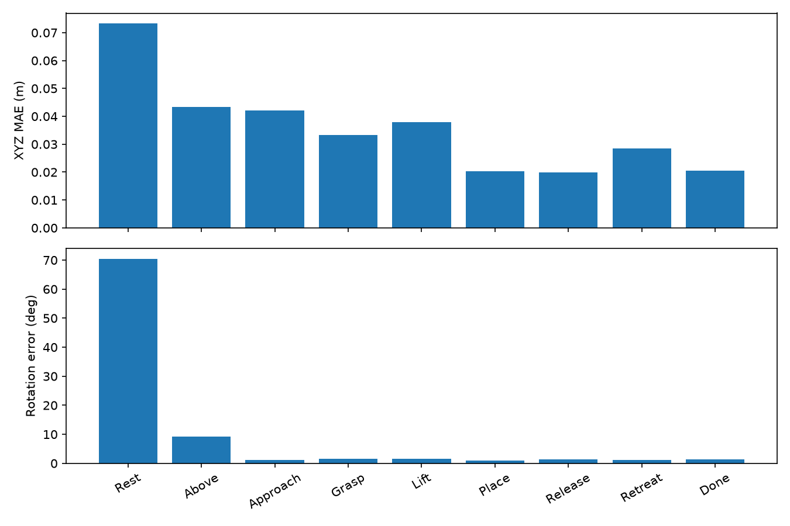
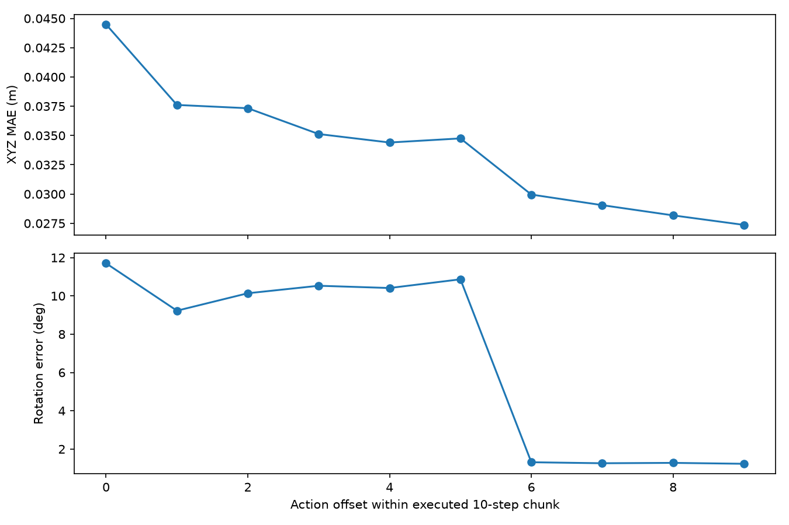
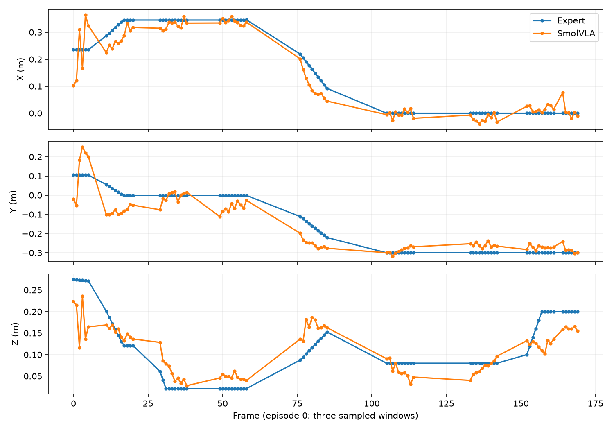

夹爪的整体 96.13% 主要反映稳定开/闭阶段。围绕 40 条验证 Episode 的首次闭合和首次松开，各取切换前后 10 帧，共 1600 帧；**窗口整体**符号准确率仅 59.06%，抓取窗口 65.13%，松爪窗口 53.0%。两类切换中各 38/40 个窗口在专家切换前已首次出现目标符号；该“首次出现”可包含振荡，不能当成持续完成切换的时间。原 20 条闭环中 19/20 曾闭合后再张开，时序错误与未抓起物体相吻合。

在 3280 帧阶段化验证样本中，专家 Open 2080 帧、Close 1200 帧；模型 Open 召回率 97.16%、精确率 96.74%，Close 召回率 94.33%、精确率 95.05%。这些整体分类指标与切换窗口 59.06% 并不矛盾：错误集中在短暂但任务关键的边界。

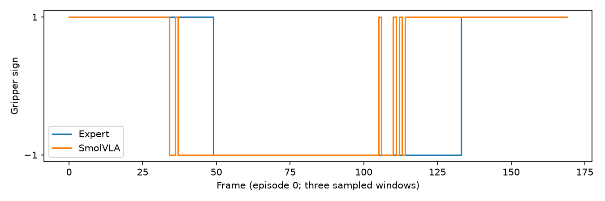
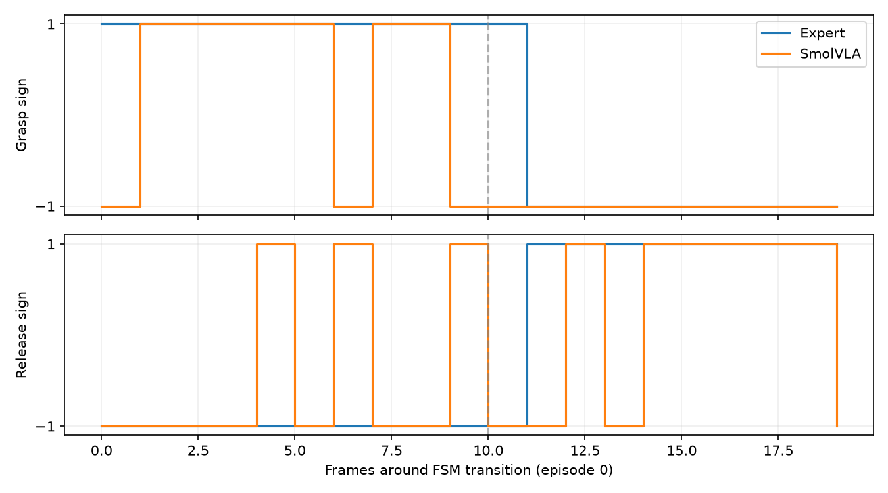

基线在同一 3280 帧阶段化验证样本计算：训练 action 均值常量预测 XYZ MAE `0.1299m`、角误差 `10.16°`、夹爪 `36.6%`；保持当前 EE 位姿并始终张开为 `0.00849m`、`5.04°`、`63.4%`。后者位置/姿态数值比模型更低，因为专家在许多帧保持目标位姿附近，**但保持策略无法主动完成任务**；这是逐帧 MAE 的局限，不能把它当作优于模型的控制策略。模型明显好于常量均值动作，却仍不能稳定完成接近、闭合、抬升与放置。

## 6. 原因分层与 ACT 对照范围

| 判断 | 等级 | 证据与限制 |
|---|---|---|
| 95 步提前截断完整任务 | **已证实** | 专家首次松爪中位 130 帧；95 帧无专家松爪 |
| 95 步是 0/20 唯一原因 | **已否定** | 同 checkpoint 固定 seed 240 步 0/3，物体未抬升 |
| 当前 Absolute IK/PD 完全不能执行成功动作 | **已否定** | 同环境脚本专家 3/3；不是旧 HDF5 字节级回放 |
| state/action 坐标系或单帧索引错位 | **未发现** | 31D 顺序和原 HDF5 action 同帧核验；模型/专家同 Absolute Pose 接口 |
| 模型动作误差、夹爪切换与安全过滤实际改变轨迹 | **已证实** | 阶段化离线误差、切换窗口 59.06%、模型 XYZ >1mm 改动 79.58% 对专家 0% |
| 重规划跳变/限速是主要因果瓶颈 | **有支持的推测** | 边界原始跳变均值 0.101m；尚无改变一个变量的闭环干预 |
| 只需延长训练即可成功 | **尚未验证** | 训练/验证 loss 同降；覆盖全部 Episode，直接加步数缺少明确隔离依据 |

已有 ACT 25 Hz checkpoint 使用 34D，包含 `object_rel_xyz` 仿真物体真值，因此输入信息强于 31D SmolVLA。历史 ACT 评估的 seed、具体 checkpoint/条件没有完整统一记录，**不可直接作为本轮公平同条件算法对照**。以下表格只记录已有接口参考，不作性能排名；旧 10 Hz ACT 成功率更不可混入 25 Hz 表。

| 策略/接口参考 | 输入与条件 | 已有成功记录 | 可比性 |
|---|---|---:|---|
| SmolVLA 1000 步 | 31D、双 RGB、95 步 | 0/20 | 原始结果，未固定环境 seed |
| SmolVLA 1000 步 | 同模型，240 步、seed `20261118…` | 0/3 | 与 95 步组配对初始物体位置 |
| 脚本 FSM 专家 | 当前 25 Hz Isaac Lab 控制接口 | 3/3 | 验证执行接口，不是学习算法对照 |
| 历史 ACT 25 Hz smoke | 34D（含物体真值）、240 步 | 2/3 | `outputs/eval/act_lebai_lm3_25hz_smoke`，不公平且条件不全 |
| 历史 ACT 25 Hz | 34D、240 步 | 0/10 | `outputs/eval/act_lebai_lm3_25hz`，同样不公平且条件不全 |

要做公平算法比较，应统一观测信息、数据、初始条件、checkpoint/队列、horizon 与成功判据后重新运行。

## 7. 下一轮单变量实验与停止条件

**最优先：测试 action queue 重规划长度。**研究问题：每 10 步重规划是否导致过大的边界目标跳变和抓取时序错误？假设：只把 SmolVLA 推理时 `n_action_steps` 从 10 改为 1，在每步拿最新观测后重规划，可降低闭环抓取阶段的原始 XYZ 跳变和错误夹爪切换。**唯一关键变量**为执行队列长度；固定 1000 步 checkpoint、31D/双 RGB、pre/postprocessor、8D Absolute Pose、安全过滤、25 Hz 策略时钟、240 步 horizon、初始 seed 集 `20261118…`、成功判据。按 LeRobot 0.7.0 实际 API 重建/清空队列，并实测每次动作确实触发新推理；不修改模型权重或控制器。至少对相同 3 个 seed 运行 10 步与 1 步成对实验，建议扩展到 20 个 seed 估计成功率。记录接近率（最小 EE–物体距离）、首次持续闭合帧、物体最大 z、放置/成功率、模型原始→执行 XYZ 改动、重规划边界跳变、推理墙钟延迟。**支持假设**：接近/抬升与夹爪切换明显改善且实际限幅差缩小；**否定假设**：同 seed 仍不能抬升且上述指标无改善，或一步重规划造成更大抖动。若无抬升改善，停止以队列长度为主线，转而验证视觉/状态与抓取阶段策略；即使改善，也须报告 0.126s 级重规划无法保证 25 Hz 实时墙钟。

后续按证据顺序：

| 实验 | 研究问题/待验证假设 | 唯一变量；固定条件 | 指标与支持/否定、停止条件 |
|---|---|---|---|
| 专家前缀交接 | 模型主要卡在接近/抓取，还是后续放置？ | 用脚本专家执行到首次稳定抓起再交接 SmolVLA；同环境、seed、checkpoint、240 步、控制器 | 若交接后能放置，支持早期阶段为主瓶颈；若仍失败，后期策略也有问题。3 条仅诊断，扩展后再统计 |
| 仅夹爪时序干预 | 错误切换是否足以解释未抬升？ | 用 FSM 的夹爪符号替换模型第 8 维，XYZ/姿态与过滤不变；固定 seed、horizon | 若抬升率上升，支持时序因果贡献；若无变化，停止单独修夹爪方向；注意该实验引入仿真真值，仅用于诊断 |
| 增加训练步数（暂缓） | 当前行为误差是否来自优化不足？ | **前述接口消融后**才固定数据/架构与评估，只延长新训练 run 的 optimizer steps，不覆盖 1000 步结果 | 需阶段化 train/val 误差、切换窗口、原始→执行动作差与配对闭环成功率同时改善；若 val 或闭环不改善，停止加步数。现有覆盖和 loss 不能支持立即启动 |

仿真固定 seed 仍可能有物理/渲染非确定性；至少报告初始物体位置、相机条件和多 episode 分布。所有离线预测使用真实观测且不反馈动作，其指标不能直接替代闭环效果。当前最可能的失败链为：95 步截断了完整任务；即使延长，模型在接近/抓取阶段的目标与夹爪时序误差造成大量安全限幅，物体没有被稳定抬起，随后向托盘运动没有负载。链条中“限幅/队列跳变是独立根因”的权重仍需上述单变量实验确定。

## 8. 本轮可复核命令

以下是本轮诊断使用的命令形式，均在项目根目录执行；输出路径已有文件，**重跑需换新目录/文件名，避免覆盖**。不包含训练命令。

```bash
cd ~/isaac_space_01/act_manipulation
PY="$PWD/.conda/smolvla_lebai/bin/python"
ISAAC_PY=/home/l/miniconda3/envs/env_isaaclab/bin/python
"$PY" smolvla_lebai/scripts/analyze_training_coverage.py
"$PY" smolvla_lebai/scripts/eval_checkpoint_loss.py --output outputs/eval/smolvla_diagnostics/checkpoint_loss_new.json
"$PY" smolvla_lebai/scripts/test_smolvla_inference.py --checkpoint outputs/train/smolvla_lebai_1000 --episodes 40 --split val --fsm-windows --frames-per-episode 10 --output outputs/eval/smolvla_lebai/val_fsm_windows_new.json
"$PY" smolvla_lebai/scripts/test_smolvla_inference.py --checkpoint outputs/train/smolvla_lebai_1000 --episodes 40 --split val --transition-windows --output outputs/eval/smolvla_lebai/val_transition_windows_new.json
"$PY" smolvla_lebai/scripts/diagnose_failure.py
"$PY" smolvla_lebai/scripts/plot_horizon.py
"$ISAAC_PY" smolvla_lebai/scripts/rollout_smolvla_isaac.py --headless --num-episodes 3 --max-policy-steps 95 --smol-seed 20261118 --output-dir outputs/eval/smolvla_h95_new
"$ISAAC_PY" smolvla_lebai/scripts/rollout_smolvla_isaac.py --headless --num-episodes 3 --max-policy-steps 240 --smol-seed 20261118 --port 18766 --output-dir outputs/eval/smolvla_h240_new
"$ISAAC_PY" scripts/record/scripted_act_data_colletion_25hz.py --headless --target-episodes 3 --save-dir outputs/eval/expert_replay_new
```

图均为实际数值或相机帧生成，位于 `smolvla_lebai/figures/`；没有虚构视频或实机成功。诊断脚本只读源数据与 checkpoint；`diagnose_failure.py`/`plot_horizon.py` 会写统计图和 JSON，运行前应为旧结果另设目标或备份，避免覆盖已有诊断图。
